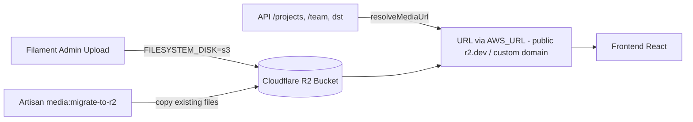

# Implementation Plan — Integrasi Cloudflare R2 untuk Penyimpanan Media

> **Project**: Accaive Design Studio (`accaivedesign.id`)
> **Scope**: Backend Laravel 11 + Filament v3 (`/backend`)
> **Dibuat**: 2026-10-14
> **Status**: Siap dikerjakan (plan untuk agent pelaksana)

---

## Problem Statement

Media (gambar project, team, service, program, exhibition, featured story, dan about-page) saat ini disimpan di disk lokal `storage/app/public` pada server Railway. Ini bermasalah karena filesystem Railway bersifat **ephemeral** (hilang saat redeploy) dan tidak scalable.

**Tujuan**: Memindahkan seluruh penyimpanan & penyajian media ke **Cloudflare R2** (S3-compatible), dengan bucket **publik** yang diakses lewat custom/`r2.dev` domain, memigrasi media lama yang sudah ada, dan hanya mengaktifkan R2 di **produksi** (lokal tetap `local`).

---

## Requirements (keputusan yang sudah disepakati)

| # | Keputusan | Pilihan |
|---|-----------|---------|
| 1 | Akses publik media | **Public bucket** via `AWS_URL` (custom domain / `pub-xxx.r2.dev`) |
| 2 | Media lama | **Migrasi semua** dari `storage/app/public` ke R2 |
| 3 | Scope environment | **Produksi saja** pakai R2 (`FILESYSTEM_DISK=s3`); lokal tetap `local` |

---

## Background (temuan dari kode — SUDAH ADA)

- ✅ `league/flysystem-aws-s3-v3` **sudah terpasang** di `backend/composer.json`.
- ✅ Disk `s3` **sudah terdefinisi** di `backend/config/filesystems.php`, lengkap dengan `endpoint`, `url`, `use_path_style_endpoint` (dibutuhkan R2).
- ✅ `App\Support\ApiHelper::resolveMediaUrl()` **sudah punya cabang** `s3`:
  ```php
  $disk = config('filesystems.default', 'public');
  if ($disk === 's3') {
      return Storage::disk('s3')->url($path);
  }
  return url('storage/' . ltrim($path, '/'));
  ```

### Yang BELUM lengkap / perlu dikerjakan

- ⚠️ Filament `FileUpload` di **7 lokasi** tidak menyebut `->disk()` secara eksplisit (ikut default disk):
  - `backend/app/Filament/Resources/ProjectResource.php` — `hero_image` (`projects/hero`), `gallery_images` (`projects/gallery`, multiple)
  - `backend/app/Filament/Resources/TeamMemberResource.php` — `photo` (`team`)
  - `backend/app/Filament/Resources/ServiceResource.php` — `image` (`services`)
  - `backend/app/Filament/Resources/ProgramResource.php` — `image` (`programs`)
  - `backend/app/Filament/Resources/ExhibitionResource.php` — `image` (`exhibitions`)
  - `backend/app/Filament/Resources/FeaturedStoryResource.php` — `image` (`stories`)
  - `backend/app/Filament/Pages/ManageAboutPage.php` — `about_hero_image`, `about_hub1_image`, `about_hub2_image` (`about`)
- ⚠️ `backend/.env.example` belum punya variabel R2 (`AWS_ENDPOINT`, `AWS_URL`).

### Media field di database

Path disimpan **relatif** (mis. `projects/hero/xxx.png`), konsisten antara disk `local` & `s3`. **Konsekuensi penting: migrasi file TIDAK perlu mengubah path di DB — cukup menyalin file.**

| Tabel / sumber | Kolom media | Catatan |
|----------------|-------------|---------|
| `projects` | `hero_image` (string), `gallery_images` (jsonb array) | gallery = array path |
| `team_members` | `photo` | |
| `services` | `image` | |
| `programs` | `image` | |
| `exhibitions` | `image` | |
| `featured_stories` | `image` | |
| `site_settings` (key-value) | keys: `about_hero_image`, `about_hub1_image`, `about_hub2_image` | di-resolve di route `/settings` |

Media lokal ±334MB tersimpan di `backend/storage/app/public/{about,projects/hero,projects/gallery,services,team,programs}`.

---

## Proposed Solution (high-level)

1. Konfigurasi disk R2 (reuse disk `s3` yang sudah ada) + env R2 untuk produksi; `visibility=public` agar objek dapat diakses langsung.
2. Buat Artisan command idempotent `media:migrate-to-r2` untuk menyalin seluruh file dari disk `public` lokal ke disk `s3` (R2), dengan verifikasi & skip file yang sudah ada.
3. Pastikan semua `FileUpload` Filament & `resolveMediaUrl` konsisten memakai disk default (yang menjadi `s3` di produksi), sehingga upload baru langsung ke R2 dan URL ter-resolve ke domain R2.
4. Dokumentasikan langkah setup R2 (buat bucket, API token, public access, env di Railway) + verifikasi end-to-end.

### Arsitektur



---

## Task Breakdown

### Task 1: Siapkan & dokumentasikan resource Cloudflare R2 + variabel environment
- **Objektif**: Membuat panduan konkret pembuatan bucket R2, API token (Access Key/Secret), mengaktifkan public access (r2.dev atau custom domain), dan menetapkan daftar env yang dibutuhkan.
- **Guidance**: Tambahkan variabel ke `backend/.env.example`:
  ```env
  # Cloudflare R2 (S3-compatible) — isi nilai asli hanya di environment Railway
  AWS_ACCESS_KEY_ID=
  AWS_SECRET_ACCESS_KEY=
  AWS_DEFAULT_REGION=auto
  AWS_BUCKET=
  AWS_ENDPOINT=https://<ACCOUNT_ID>.r2.cloudflarestorage.com
  AWS_URL=https://<PUBLIC_R2_DOMAIN>
  AWS_USE_PATH_STYLE_ENDPOINT=true
  # Set FILESYSTEM_DISK=s3 HANYA di produksi (Railway). Lokal tetap local.
  ```
  Buat dokumen `backend/R2_SETUP.md` (atau tambahkan ke `DEPLOYMENT_GUIDE.md`) berisi langkah setup R2 & nilai env untuk Railway. **Jangan menaruh kredensial asli di repo.**
- **Test**: Verifikasi `.env.example` ter-parse (tidak ada syntax error) dan dokumentasi mencakup semua env yang dirujuk config.
- **Demo**: Pembaca dapat mengikuti dokumen untuk membuat bucket R2 dan tahu persis env apa yang harus diisi di Railway.

### Task 2: Finalisasi konfigurasi disk `s3`/R2 di Laravel
- **Objektif**: Pastikan disk `s3` di `config/filesystems.php` siap untuk R2 publik dan `FILESYSTEM_DISK` dapat di-switch ke `s3` di produksi tanpa memengaruhi lokal.
- **Guidance**: Tambahkan `'visibility' => 'public'` pada disk `s3` (agar objek baru dapat diakses publik, bila bucket pakai policy publik). Konfirmasi `url` memakai `AWS_URL`. Pastikan default lokal tetap `local` via `.env` (tidak di-commit). **Tidak mengubah perilaku lokal.**
- **Test**: `php artisan config:clear && php artisan about` berjalan tanpa error; tulis unit test kecil yang memanggil `Storage::disk('s3')` dalam mode `Storage::fake` untuk memastikan konfigurasi disk valid.
- **Demo**: Dengan `FILESYSTEM_DISK=s3` + env R2 terisi, `Storage::disk('s3')->url('projects/hero/x.png')` menghasilkan URL berbasis `AWS_URL`.

### Task 3: Buat Artisan command migrasi media `media:migrate-to-r2`
- **Objektif**: Command idempotent yang menyalin semua file dari disk `public` lokal ke disk `s3` (R2).
- **Guidance**: Buat `backend/app/Console/Commands/MigrateMediaToR2.php`. Iterasi `Storage::disk('public')->allFiles()`, untuk tiap file:
  - skip bila sudah ada di `s3` (opsi `--force` untuk overwrite),
  - stream-copy ke `s3` dengan `visibility public`,
  - tampilkan progress bar + ringkasan (jumlah disalin / dilewati / gagal).
  - Tambahkan opsi `--dry-run` untuk pratinjau tanpa upload.
  - Karena path relatif identik, **DB tidak perlu diubah**; sertakan verifikasi opsional yang memindai field media di DB dan memastikan objek ada di R2.
- **Test**: Feature test dengan `Storage::fake('public')` + `Storage::fake('s3')`, seed beberapa file dummy, jalankan command, assert file muncul di disk `s3`, dan assert idempotensi (run kedua = semua "skipped").
- **Demo**: `php artisan media:migrate-to-r2 --dry-run` menampilkan daftar file yang akan dimigrasi; tanpa flag, menyalin file dummy ke disk fake s3 dan melaporkan ringkasan.

### Task 4: Seragamkan upload Filament & resolusi URL agar konsisten dengan disk aktif
- **Objektif**: Pastikan semua `FileUpload` dan penyajian URL mengikuti disk default aktif (local di dev, s3 di prod) tanpa hardcode yang memecah salah satu environment.
- **Guidance**: Tinjau 7 titik `FileUpload` (lihat daftar di Background). Biarkan mengikuti default disk (perilaku saat ini) ATAU set eksplisit `->disk(config('filesystems.default'))` + `->visibility('public')` secara konsisten agar jelas. Konfirmasi `ApiHelper::resolveMediaUrl` menangani kedua disk dengan benar (sudah ada; verifikasi untuk gallery array & about keys). **Tidak mengubah struktur `->directory()`** agar path lama tetap cocok.
- **Test**: Jalankan test backend existing (`php artisan test`) agar tetap 13 passed; tambah test unit untuk `resolveMediaUrl` pada kedua skenario disk (local → `url(storage/..)`, s3 → `AWS_URL/..`).
- **Demo**: Upload gambar baru lewat Filament di mode s3 tersimpan di R2 dan muncul di frontend; di lokal tetap tersimpan di `storage/app/public`.

### Task 5: Verifikasi end-to-end & finalisasi dokumentasi deployment
- **Objektif**: Memastikan seluruh rantai (upload → R2 → API → frontend) bekerja dan terdokumentasi untuk rollout produksi.
- **Guidance**: Jalankan `php artisan test`, `php artisan about`. Dokumentasikan urutan rollout di Railway:
  1. Set env R2 di Railway, set `FILESYSTEM_DISK=s3`.
  2. Deploy.
  3. Jalankan `php artisan media:migrate-to-r2`.
  4. Verifikasi beberapa endpoint API mengembalikan URL R2.
  5. Cek gambar tampil di `accaivedesign.id`.
  - Tambahkan catatan rollback (set `FILESYSTEM_DISK=local` kembali).
  - Perbarui `CONVERSATION_SUMMARY.md` dengan fase R2 ini.
- **Test**: Checklist verifikasi manual — `curl` endpoint `/api/projects` mengembalikan `hero_image` berawalan `AWS_URL`; gambar dapat dibuka di browser (200 OK).
- **Demo**: Dokumen rollout lengkap + bukti satu endpoint API mengembalikan URL R2 yang valid dan gambar tampil di frontend produksi.

---

## Catatan Keamanan

- **JANGAN** menaruh kredensial R2 asli (Access Key / Secret) ke repo. Gunakan placeholder di `.env.example` dan dokumentasi saja.
- Nilai asli diisi langsung di environment Railway (dan `.env` lokal yang tidak di-commit).
- Bucket publik hanya untuk aset media gambar yang memang ditujukan tampil publik. Jangan simpan file sensitif di bucket yang sama.

## Prinsip Umum untuk Agent Pelaksana

- Path media di DB relatif dan identik lintas disk → **jangan rewrite path DB** kecuali verifikasi menemukan anomali.
- Jaga agar environment **lokal tidak berubah perilakunya** (tetap `local`).
- Pertahankan hasil test backend tetap hijau (baseline: 13 tests passed, 31 assertions).
- Command migrasi harus **idempotent** dan punya `--dry-run`.
